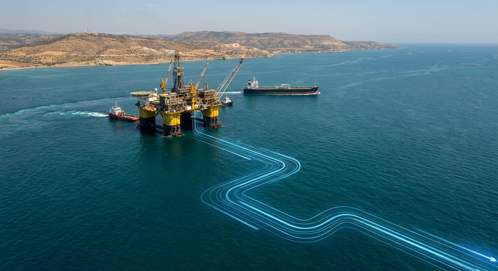

# Новости Кипр — Иран: 03 ноября 2026 (утро)

*Автоматический сбор. Найдено статей: 1*

---

## 1. Кипр подписал контракт на $1,8 млрд на экспорт газа через Египет

> **Источник:** Серия: cyprus-natural-gas-export-plans | **Дата:** 31.10.2026 15:24 | **Теги:** `газ` `экспорт` `Египет` `контракты` `энергетика` `инвестиции` `Кипр на энергетической карте Европы`

> [Оригинал: Cyprus signs $1.8bn deal to develop first gas field, with exports to Europe via Egypt](https://news.google.com/rss/articles/CBMifEFVX3lxTE5ESUNmVDhJMmZSamg1SFBFUW9LcHZOSWZXMzM0V0cwN0pMeExUd3VUQnhuMFpGbmdOR0MwVnlneGVSLUpORWZvN1RmamNVa1ljNG5RRGdRZFVVMkRpZHM3dVZ2SDE4RlhZVS1ZUXlEVGd0VzdscHpqV2JjbFg?oc=5)

Первый природный газ из-под Кипра попадёт в Европу не прямой трубой, а через Египет. Это может показаться странным маршрутом, но на самом деле это выигрыш для всех: для Кипра, для Египта, для Европы и — главное для вас — для бизнеса на острове. $1,8 млрд на контракт, первый газ в 2028 году, и новая волна возможностей для тех, кто поймёт, как её ловить.

### Историческая сделка для Кипра

Кипр только что подписал соглашение на разработку месторождения Кронос. Контракт на добычу газа стоимостью $1,8 млрд — это не просто нефтяная сделка номер N на острове. Это историческое событие. Остров, в экономику которого долгие годы вливались туристические доллары и кипрские банки, вдруг получает доступ к энергетическому активу мирового масштаба.

Для контекста: ВВП Кипра в районе 40 млрд долларов в год. Один контракт приносит 4–5% годового национального дохода за несколько лет. Это серьёзные деньги, которые потекут в казну. Месторождение лежит на дне Средиземного моря примерно в 200 км южнее острова. Кипр давно знает, что оно там есть. Проблема была в том, как его оттуда достать, не разорившись на инфраструктуре и политических комплюсах.

### Восемь лет ожидания

История месторождения Кронос — это история проб и ошибок. Кипр открыл газ в этом районе в 2018 году. Восемь лет спустя, в 2026-м, подписан первый большой контракт на разработку. Восемь лет потому, что выбрать маршрут экспорта, согласовать с соседями, получить разрешения, найти компанию, которая согласна ввязаться в проект, — всё это сложнее, чем звучит.

На Средиземноморье каждый кубометр газа пересекается с интересами нескольких государств. Турция смотрит, что Кипр делает. Греция смотрит, Израиль смотрит. Каждый хочет себе кусок энергетического пирога. Кипр меньше всех, но это его земля. Поэтому нужно было не просто найти газ, но и найти способ его продать, не нажимая на опасные кнопки региональных конфликтов.

### Почему маршрут через Египет

Теоретически можно было бы протянуть трубу прямиком из Кипра в Европу. Такие трубопроводы существуют. Но это дорого, долго и политически сложно. Прямой маршрут Кипр-Европа потребовал бы постройки оборудования для сжижения газа прямо на Кипре или на дне моря. Это сотни миллионов дополнительных расходов, годы строительства. И всё равно Кипру нужно было бы договариваться с Европой о прямом доступе к её инфраструктуре.

Египет уже имеет полностью готовую систему. Там стоят терминалы для сжижения, оборудование, система танкеров, контракты с европейскими странами на поставку. Когда газ движется через трубу в другую страну, его нужно где-то обработать, чтобы его можно было погрузить на корабль. Через Египет всё проще: газ попадает на египетский берег, там входит в уже существующую систему переработки, сжимается, охлаждается, грузится на танкеры и отплывает в Европу.

Маршрут короче, система подготовлена, контракты на поставку в Европу уже в силе. Никаких нот протеста от Турции, потому что это просто торговля между тремя странами. Для Кипра это выход из политического лабиринта в чистую экономику.

### Кто выигрывает в этой схеме

Кипр выигрывает деньги и стабильность. Газовый доход предсказуем на десятилетия вперёд. Инвесторы видят в этом знак того, что остров экономически стабилен и диверсифицирован.

Египет выигрывает статусом энергетического хаба не только для своего газа, но и для газа соседей. Это привлекает инвестиции в египетский энергетический сектор, создаёт рабочие места, позиционирует страну как ключевого игрока на карте энергопередач.

Европа выигрывает надёжным источником газа, который не зависит от украинских трубопроводов, не требует сложных морских маршрутов через Турцию и не нуждается в полит договорённостях со странами, которые меняют правила по настроению. Это диверсификация источников, безопасность, предсказуемость поставок.

### Деньги и рабочие места на Кипре

Если вы на Кипре или планируете переехать — вам выигрыш в трёх плоскостях одновременно.

Первое: прямые рабочие места. Разработка месторождения требует специалистов — геологов, инженеров, техников, координаторов проектов, логистов, специалистов по безопасности. На Кипре этих людей мало. Значит, будут нанимать иностранцев. Если вы работаете в energy, engineering, logistics — это прямой спрос на ваши услуги. Зарплаты в этих секторах на острове начнут расти, потому что конкуренция за кадры обострится.

Второе: косвенные возможности. Все эти инженеры, которые приедят на проект, будут жить на Кипре, есть в ресторанах, ездить на такси, арендовать квартиры, пользоваться услугами. Если вы владеете гостиницей, апартаментами, кафе, таксопарком — спрос на ваши услуги вырастет. Если вы занимаетесь недвижимостью — риелторская комиссия и аренда будут расти годы. Даже владельцы небольших магазинов на берегу заметят прилив.

Третье: инвестиции в новые секторы. Кипр получит деньги в бюджет, экономика станет более привлекательна для капиталов. Это привлечёт компании, которые хотят открыть на острове офисы, центры обработки данных, IT-центры. Конкуренция в tech-секторе обострится, но и зарплаты вырастут. Виза для квалифицированного специалиста станет легче.

### Первые возможности появятся уже в 2027 году

Первый газ ожидается в 2028 году. Это не завтра, но это не сто лет в будущем. До этого — полтора-два года подготовки: финальные согласования, разрешения, доставка оборудования, монтажные работы. На 2026 год это звучит далеко, но в энергетике это быстро.

Компании уже сейчас начинают выстраивать контакты с Кипром, договариваться о поставках, искать местных партнёров. Если вы хотите войти в эту экосистему, лучше начать сейчас. Создать компанию, которая может обслуживать энергетический сектор. Наладить контакты. Выучить английский язык, если не говорите. Поправить визу, если нужно. Те, кто начнёт двигаться сегодня, будут в фаворе в 2027–2028 годах.

### Что меняется для всей экономики острова

$1,8 млрд — это не одноразовый платёж. Это серия платежей, которые будут идти в казну Кипра годами. Кроме того, это налоги с зарплат специалистов, которые приедят на остров. Это налоги с услуг, которые они будут покупать. Это косвенные налоги от компаний, которые откроются, чтобы обслуживать проект. Экономика получает реальный импульс, не иллюзорный.

В результате Кипр становится менее зависим от туризма. Туризм — это хорошо, но это волатильно. Когда есть коронавирус, европейцы не летают на Кипр, туризм падает, доходы падают. Когда есть политический кризис, туристы боятся, деньги не текут. Газ — это стабильнее. Газ нужен всегда, в любую погоду, в любой политической ситуации.

Для инвесторов это мощный сигнал переоценки. Остров перестаёт быть только туристическим и финансовым центром. Он становится энергетическим поставщиком региона. На глобальных картах это меняет вес Кипра. Акции кипрских компаний могут вырасти. Недвижимость может подорожать, потому что остров становится более интересен для иностранных вложений в стратегические отрасли.

### Начинать надо сейчас

Контракт на добычу газа — это точка, после которой Кипр другой. Не завтра, но через два-три года остров заметно изменится. На берегу появятся новые объекты, в городах будут работать новые люди из разных стран, деньги потекут в казну и в локальный бизнес.

Если вы на острове сейчас — это хороший момент, чтобы понять, где в этой новой системе место для вас. Если вы только думаете о переезде на Кипр — это сигнал того, что экономика острова растёт и открывается для инвестиций и талантов. Газ будет течь в Европу через Египет, но деньги будут течь на Кипр. И кусок этой прибыли может быть ваш, если вы знаете, куда смотреть и начинаете двигаться не когда все уже включились, а когда волна только собирается.

---
