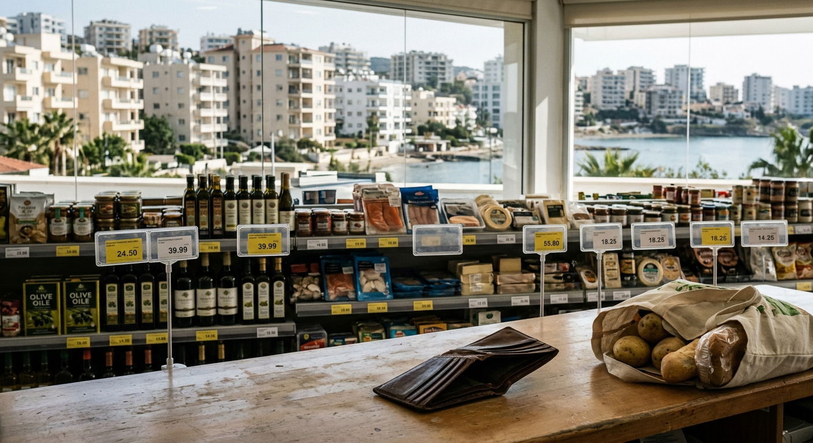

# Новости Кипр — Иран: 03 ноября 2026 (утро)

*Автоматический сбор. Найдено статей: 1*

---

## 1. На Кипре молодежь работает, но едва выживает

> **Источник:** Reddit r/cyprus | **Дата:** 01.11.2026 15:06 | **Теги:** `стоимость жизни` `молодежь` `жилье и экономика`

> [Оригинал: Young people in Cyprus are feeling the squeeze on everyday costs, housing, and their future prospects.](https://www.reddit.com/r/cyprus/comments/1xl5cgk/young_people_in_cyprus_are_feeling_the_squeeze_on/)

После оплаты квартиры, коммунальных и еды молодой киприот обнаруживает, что зарплата уходит полностью. Развлечение, экономия, путешествие — всё откладывается. И это не редкость для молодежи на Кипре. Работают, порой даже не одну работу, но вопрос не в трудолюбии — в том, что механика цен и зарплат на острове построена совсем не в их пользу.

### Начало месяца: все деньги уходят в счета

Потратьте день в компании молодых людей на острове — услышите одно и то же. Киприотка в IT работает удалённо, получает 2000 евро в месяц (конкурентная зарплата по кипрским меркам). Из них 850 евро — квартира в Никосии, 200 — коммунальные (электричество в летние месяцы может быть и дороже), 300 — еда, 150 — страховка машины и бензин. Остаток: около 500 евро. Звучит нормально? Нет. Потому что неожиданный ремонт холодильника, замена колеса или просто желание пойти в ресторан превращает эти 500 в ноль. К концу года никаких накоплений.

Так же живут врачи, учителя, инженеры. По данным из открытых источников, молодежь на Кипре сообщает о реальном финансовом стрессе: в семье из трёх человек со средней зарплатой остаток после базовых расходов составляет в среднем 10–15% от дохода. В странах ЕС этот показатель выше — часто 25–35%. При одинаковой зарплате. Кроме того, молодые люди в возрасте 25–35 лет живут с родителями не по выбору, а из экономической необходимости. Это происходит дольше, чем в среднем по ЕС.

### Почему цены на Кипре не падают

Проблема не в том, что киприоты нерачительны. Проблема в том, как работает ценообразование на острове. Во-первых, Кипр — малая экономика с ограниченным рынком. Продукты импортируются, что добавляет логистику, таможню, комиссии посредников. Литр молока здесь стоит примерно столько же, сколько в Берлине, хотя зарплата киприота часто на 20–30% ниже.

Во-вторых, конкуренция в розничной торговле слабая. Несколько крупных сетей контролируют рынок — «Carrefour», «Alphamega», местные цепочки. Это позволяет им держать цены высокими без особого давления вниз. Товар дорогой, маржа хорошая. Менеджер сети это видит, работник кассы это видит — и все молчат. Потому что уменьшить цены означает меньше прибыли, и никто по своей воле этого не делает.

Третья причина — энергетика. Летом кондиционер работает с июня по сентябрь почти круглосуточно. Счет за электричество в летние месяцы может быть 150–200 евро для стандартной квартиры. Это не ошибка и не преувеличение — это реальность. Кипр зависит от импорта энергии, цена за киловатт час остаётся высокой, и расходы на кондиционер съедают треть годового бюджета на коммунальные услуги.

### Работа есть, но денег не прибавляется

Там, где молодежь работает, босс скупится. Киприоты говорят, что работодатели хотят платить 30-летнему архитектору столько же, сколько платили 20 лет назад. Почему? Потому что медленно растущая экономика позволяет работодателю ждать. Спроса на работников меньше, чем предложения. Молодой человек видит: либо я беру то, что предлагают, либо ищу другую работу, и там то же самое. Он идет на компромисс.

Кроме того, многие работодатели не готовы платить конкурентные зарплаты даже высококвалифицированным специалистам. IT-специалист может заработать больше, беря проекты из-за рубежа, чем работая на кипрскую фирму. И многие именно так и делают — работают удалённо для немецких или швейцарских компаний. Но это требует английского языка, сертификатов, портфолио. Обычный молодой киприот, вышедший из школы, на это не готов.

### Квартира так и остаётся мечтой

Самый больной вопрос — жилье. Снять квартиру в Никосии получается за 800–1200 евро (в зависимости от района). Купить — практически невозможно молодежи на Кипре без помощи родителей. Цена квартиры в 60 квадратов в центре Никосии начинается от 250–300 тысяч евро. Чтобы её купить, нужна ипотека. Банк одобрит ипотеку, если твоя зарплата как минимум в три раза выше платежа. При зарплате в 2000 евро ты можешь взять кредит примерно на 650 евро в месяц. Это даст тебе сумму в районе 80–100 тысяч евро. Оставшиеся 150–200 тысяч должны быть собственными накоплениями. Молодой киприот копил бы 20–30 лет, чтобы на это хватило. К этому времени он уже не молодой.

Результат: молодежь на Кипре живет с родителями. По статистике из открытых источников, в возрасте 30 лет с родителями живут до 30–40% молодых киприотов. В среднем по ЕС этот показатель 15–20%. В 30 лет киприот всё ещё просит у родителей разрешение привести на выходные девушку. Это создаёт психологическое напряжение, которое молодежь хорошо описывает в социальных сетях и блогах.

### Образование не готовит к реальности рынка

Ещё одна беда — школа и университет готовят людей не к тому, что нужно рынку. Ученик оканчивает школу и идёт в университет на специальность, потому что так принято, а не потому, что на неё есть спрос. Результат: много юристов, мало слесарей и электриков. Те, кто выбрал популярные специальности, выходят на рынок тысячами, работодатель может позволить себе платить меньше. Те, кто нужен ремонту и строительству — их не хватает, но молодежь не хочет в эти сферы, потому что это считается «низким».

Профессиональное обучение на Кипре развито слабо. Хочешь стать сварщиком или монтажником кондиционеров? Программ мало, они не финансируются государством достаточно, названия специальностей в аттестате выглядят «низкостатусно» для родителей. Молодой человек прослушивает четыре года универа, выходит специалистом по туризму — и рабочего места нет. Туристический бизнес сезонный, работа есть летом, зимой нет. Или работа есть, но на условиях, близких к рабству: 1000 евро в месяц за 10 часов в день.

### Как это выглядит в других странах ЕС

В Германии молодой человек с той же средней зарплатой в 2000 евро живёт лучше. Квартира стоит столько же (800–1000), коммунальные чуть выше (250), еда примерно столько же (300–350). Но зарплата выше, чем на Кипре, в среднем на 25–35%. Кроме того, в Германии образование часто бесплатное или дешёвое, кредиты на жилье выдают по 2–3%, так что молодежь может позволить себе купить что-то к 35 годам. В Чехии ещё проще: цены ниже, а зарплаты растут быстрее.

На Кипре же молодежь попадает в ловушку: экономика замедленного роста не создаёт новых рабочих мест, работодатели не повышают зарплаты, жилье становится недоступнее с каждым годом. Госпрограмм поддержки молодёжи практически нет. Субсидии на жилье или кредиты с низкой ставкой — редкость. Государство помогает, но помощь незначительна и требует лишних бумаг.

### Куда смотреть, если ты молодой киприот

Что делать? Если ты IT-специалист или фрилансер — работай удалённо для иностранных компаний. Зарплата будет в два-три раза выше, жизнь сразу станет комфортнее. Если ты в других сферах — ищи работу не на Кипре, а переезжай. Много киприотов уехали в Германию, Швейцарию, Австралию. Они отправляют деньги семье, сами копят на жилье там, где оно дешевле.

Альтернатива — ждать перемен в экономике острова. Новые инвестиции, новые рабочие места, рост ВВП. Но это не произойдёт завтра. Молодежь на Кипре это понимает. И каждый месяц, когда деньги кончаются к 25-му числу, этот выбор становится всё более очевидным: либо ты приспосабливаешься к цифровой работе и переводной жизни, либо ты уезжаешь туда, где молодость означает не выживание, а начало.

В конце концов, эта проблема не нова. Кипр сталкивался с волнами эмиграции раньше. Молодежь уходит туда, где её труд ценится дороже, а жизнь стоит меньше. Остров это видит, но системно менять ничего не спешит. А молодые люди сами принимают решение: они не пассивно ждут, когда кто-то разберётся, — они берут и едят.

---
