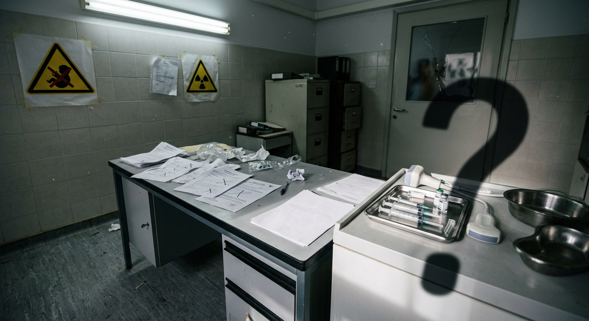

# Новости Кипр — Иран: 05 ноября 2026 (утро)

*Автоматический сбор. Найдено статей: 1*

---

## 1. Учёные доказали что обман доноров на Кипре это система а не ошибка одной клиники

> **Источник:** Серия: eko-donors | **Дата:** 02.11.2026 09:32 | **Теги:** `Скандал в клиниках ЭКО` `репродуктивный туризм` `ЭКО на Кипре`

> [Оригинал: Women travel thousands of miles for a reproductive moonshot. Scientists say they've been misled - STAT](https://news.google.com/rss/articles/CBMingFBVV95cUxQcUR0VE91eGF2OWt6UE9NVGpQbFNKUzFkUGxOT0JROEVOVWV2c0N6R2Itamd1QVhVU1Bicng2VjEzeFJBWlU3T3dCLW1oamFYOTBGX0dhNkRlZnNROHc1N3gxVjZIX2dONFRwb0Zxa1N3Nm90UE1lZXJaWW1lV1JHV1pmeHpISThzdF9laG5wQjlMbzdpdEE5OTd2X3RNQQ?oc=5)

В прошлой части мы выяснили: Турция арестовала 36 человек по делу о контрабанде яйцеклеток на Северный Кипр. Казалось бы, уголовная линия. Киллеры пойманы, нить ведёт из Турции на Кипр. Но параллельно, почти незаметно, произошло кое-что более страшное: международные учёные опубликовали исследование, которое переворачивает всю историю.

Оказалось, что ошибка, ложь, подмена доноров — это не сбой в работе одной никосийской клиники и не преступление группы контрабандистов. Это норма индустрии. Система, в которой обман вплетён в саму ткань репродуктивного туризма на Кипре.

### История расширяется

До арестов в Турции история выглядела понятно. Одна клиника. Тридцать семей. Перепутали доноров — может, ошибка, может, умышленно, но ограниченный скандал. Два месяца назад казалось, что это конец. BBC нашла проблему, Северный Кипр арестовал людей, и на этом медленно всё сойдёт на нет.

Но вот новое исследование, проведённое группой учёных из нескольких европейских университетов, говорит совсем другое. Они опросили сотни женщин, которые приезжали на ЭКО на Кипр, в Грецию, в Испанию, в Чехию. И выяснили: введение в заблуждение относительно донорского материала — это не редкий случай. Это шаблон. Его повторяют разные клиники, разные страны, разные системы.

На Кипре это выглядит особенно ярко потому, что ценовая конкуренция жёсткая. Яйцеклетки здесь стоят в два, иногда в три раза дешевле, чем в Британии или в США. Эта дешевизна привлекает тысячи семей ежегодно. И эта же дешевизна — по данным исследования — коррелирует с отсутствием прозрачности. Когда конкурируют по цене, контроль падает. А если контроль падает, растут соблазны.

### Дешевизна и её цена

Учёные поставили простой вопрос: женщины, которые приезжали на процедуру, получили ли полную информацию о том, чей материал они используют? Получили ли они документы, фото, мединформацию о доноре, как обещано? Верификацию через независимые источники?

Ответы показали, что нет. Не получили. Вместо этого они получили каталог — красивую брошюру или интернет-сайт с анкетами. Фото, описание внешности, иногда биография. Семья выбирает, подписывает контракт, платит деньги. А потом через две недели, через месяц, через год появляется ребёнок, и от любопытства или из-за болезни делают генетический тест. И тест говорит: биологический родитель — совсем не тот человек, чьи фото и данные лежали в папке.

Проблема не только в том, что произошла подмена. Проблема в том, что клиники, когда об этом узнали, молчали. Или говорили, что ошибка в документации. Или что невозможно узнать, кто на самом деле был донором, потому что записи потеряны. Или что сама женщина неправильно поняла контракт.

Исследование не говорит, сколько всего случаев такого произошло на Кипре. Но оно говорит: это не единичные ошибки. И это не только Северный Кипр. Это паттерн, который повторяется везде, где есть спешка и давление на цену.

### Кипр в огнях

Для репродуктивного туризма на Кипре это исследование — холодный душ. Остров держится на двух ногах: низкая цена и отсутствие очереди. В Британии женщина может ждать ЭКО через NHS годами, а на Кипре — две недели и процедура. Вот и приезжают тысячи британцев, немцев, скандинавов, австралийцев, других русскоговорящих семей ежегодно.

Но если выясняется, что система, на которой это держится, предполагает риск обмана, картина меняется. Семьи начнут требовать больше. Они начнут запрашивать независимую верификацию доноров. Банки спермы и яйцеклеток, такие как Cryos International, будут чаще вносить клиники в чёрные списки. Британское правительство уже выпустило официальное предупреждение для своих граждан — что Кипр, это не автоматическое гарантия безопасности.

Но главное — что теперь есть научное подтверждение. Учёные, а не только журналисты BBC, говорят: да, здесь что-то не так. Это не паранойя, не единичный скандал. Это системная проблема, и она должна быть разрешена.

### Что теперь

Для женщин, которые уже прошли ЭКО на Кипре, исследование даёт неприятное предложение: если сомневаетесь, делайте ДНК-тест ребёнку. Через год, через пять лет, всё равно. Проверяйте. Требуйте от клиники полной документации — не только фото донора из каталога, но и его реальные медицинские данные, результаты анализов, подтверждение личности. Если клиника отказывается предоставить это, это красный флаг.

Для предпринимателей в сфере репродуктивного туризма это — очень конкретный сигнал: если вы не усилите стандарты прозрачности сейчас, завтра ваша репутация станет алиасом для обмана. Уже сейчас семьи ищут клиники, которые работают с международными банками спермы и яйцеклеток, которые публикуют отзывы в открытых источниках, которые дают гарантии. Те, кто на это идёт, выживут. Остальные будут вычеркнуты.

Но остаётся главный вопрос: сколько детей, рождённых на Кипре за последние десять лет, на самом деле знают, чьи гены они носят? Сколько семей ещё не делали тесты, потому что не знают, что нужно проверять? И как долго клиники смогут молчать, если начнут говорить люди?

В следующей части — ответы.

И новые имена.

---
