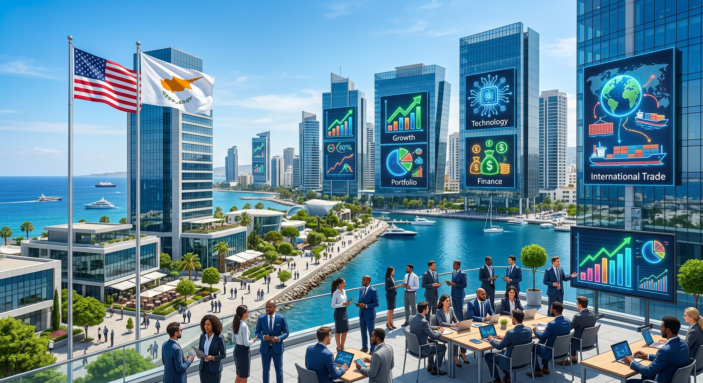

# Новости Кипр — Иран: 07 ноября 2026 (утро)

*Автоматический сбор. Найдено статей: 1*

---

## 1. Кипр объявил четырёхлетнюю охоту за американским капиталом

> **Источник:** Cyprus Mail | **Дата:** 07.11.2026 02:24 | **Теги:** `инвестиции` `бизнес на Кипре` `американский капитал` `релокация` `Кто уходит из Лимассола`

> [Оригинал: Cyprus unveils plan to court American investors](https://cyprus-mail.com/2026/11/07/cyprus-unveils-plan-to-court-american-investors)

Три месяца назад из офисов BrainRocket в Лимассоле вывезли полторы тысячи сотрудников. Никаких объяснений, никакого прощания — просто исчезновение. Потом Hadassah открыла медицинский центр, израильские инвесторы начали скупать недвижимость, стало ясно: Кипр после BrainRocket это не один упавший хаб, а множество переформатирующихся возможностей. На этой неделе правительство выложило карты полностью. И все они указывают в одну сторону: на Америку.

7 ноября 2026 года в Никосии прошла конференция американской торговой палаты. Из кабинета приехал Министр внутренних дел и озвучил то, что казалось невозможным ещё месяц назад: Кипр официально представил четырёхлетнюю стратегию по привлечению иностранных инвесторов и квалифицированных работников. Стратегию, которая прямо связана с углублением отношений между Кипром и США.

Это не новостной сюжет. Это признание собственного краха, переодетое в стратегический поворот.

### Финтех больше не спасает

Вспомним, что было три месяца назад. BrainRocket уходила тихо, но город гудел. Министерство отрицало связь между ростом налогового бремени (с 12,5% до 15%) и исходом компании, но никто не верил. Бизнес-палата требовала объяснений. AmCham впервые открыто сказала: регулирование финтеха давит, и компании это ощущают.

Потом были недели, когда казалось, что технологический сектор просто спадает. FDCTech объявила о переезде из Калифорнии, и это выглядело парадоксально: одна уходит, другая приходит. Но затем становится ясно: это не парадокс, это переключение каналов.

Invest Cyprus представила новую бренд-стратегию, в которой перестала упираться в финтех и начала говорить о диверсификации. Это была фраза, которая значила одно: старая модель сломалась, нам нужна другая. Правительство признало, что зависимость от одной отрасли, одной компании, одного конкретного бизнеса-модели — это смертельный риск. Полторы тысячи сотрудников в BrainRocket, и вот уже рухнула вся стратегия инвестиционной привлекательности.

Теперь, в начале ноября, эта новая модель объявлена вслух на конференции американской торговой палаты.

### Почему Америка, а не Европа

Министр представил стратегию не в кабинете на пресс-конференции, а именно на конференции AmCham. Это выбор места, и это сигнал.AmCham три месяца назад выступила с открытой критикой регулирования финтеха. Посол США требовала, чтобы правительство пересмотрело подход. На Кипре это звучало как внешнее давление, но правительство решило не упираться в ответ, а сдвинуться. И вот результат: озвученное признание, что мы слышим, что вот вам четырёхлетняя стратегия привлечения капитала именно из США.

Но это не просто торговая предусмотрительность или ответ на дипломатическое давление. На фоне растущей роли Америки в оборонном сотрудничестве с Кипром эта инвестиционная стратегия выглядит как часть большей геополитической переориентации. Кипр, который десять лет искал баланс между европейскими инвесторами, британским наследием и ближневосточными деньгами, теперь явно разворачивается на Запад, на США.

Оборонное сотрудничество это не случайность. Когда власти поворачиваются геополитически, инвестиции и бизнес следуют за ними, а не наоборот. Стратегия привлечения американского капитала это одновременно экономический ход и политический.

### Что стоит в самой стратегии

Слово "квалифицированные работники" в анонсе это не просто красивое прилагательное. Это означает: Кипр ищет не финансовые фонды, которые прилетят на месяц и уедят с прибылью, а компании, которые откроют офисы, наймут кипрских специалистов, привезут своих топ-менеджеров и научат локальные таланты.

Четыре года — это долгосрочность, и это либо признак того, что план действительно серьёзен, либо горизонт, дальше которого правительство видеть не может. За четыре года ситуация может измениться так, что от стратегии ничего не останется. Но объявить именно на таком сроке это показатель уверенности, пусть даже поддельной.

Диверсификация вместо одной ставки — это впервые произнесено вслух как основной урок BrainRocket. Правительство признаёт: если класть все яйца в финтех, в один сектор, в одну компанию, катастрофа неизбежна. Поэтому нужен портфель: американские стартапы в разных областях, корпорации из разных индустрий, специалисты с разными навыками.

Но реальных инструментов пока не объявлено. Что изменится в налоговой политике для привлечения американского капитала? Какие визовые упрощения будут? Какая инфраструктура для них подготовлена? Какие приоритеты по отраслям? Всё это на бумаге, всё это обещание. Механики нет.

### Кто начал двигаться раньше объявления

Странное совпадение, но не совпадение: за неделю до анонса стратегии на Кипре объявилось ещё несколько историй, которые выглядят как её предварительное осуществление.

XM, кипрский форекс-брокер, третий год подряд входит в топ работодателей Европы и продолжает расширяться. Израильская компания Hadassah открыла медицинский центр в Лимассоле — это признак того, что венчурная культура на острове не умерла, а трансформировалась под новые инвесторы. Недвижимость на Кипре покупают израильские инвесторы. И теперь, похоже, будут покупать американские.

Может быть, эта четырёхлетняя стратегия это не начало, а оформление того, что уже в процессе? Рынок уже переориентировался, капитал уже ищет Кипр под новым углом, компании уже переезжают. И правительство просто, наконец, решило поймать волну вместо того, чтобы стоять на пляже и смотреть, как она проходит мимо?

### Что изменится на практике

Для айти-специалистов на Кипре это может означать либо роскошь, либо угрозу, либо то и другое одновременно. Если американские компании откроют офисы и будут нанимать локальных разработчиков, спрос вырастет, зарплаты поедят вверх, условия улучшатся. Но если привезут готовые команды из Штатов, локальные кадры могут остаться не при чём.

Для предпринимателей, которые год прожили в неопределённости после ухода BrainRocket, это может означать возвращение уверенности. Limassol Chamber Business Barometer три недели назад выпустила опрос, в котором бизнес-сообщество назвало главные боли: не налоги, а неопределённость, нестабильность регулирования, непредсказуемость государственной политики. Если эта стратегия будет означать хотя бы видимость стабильности, это уже что-то.

Для традиционных инвесторов — русскоязычных, европейских, ближневосточных — это может означать, что их вес в политике острова уменьшится. Острый разворот в сторону США это не всегда благоприятно для тех, кто привык быть у руля. Налоговая политика может измениться в один момент. Визовые требования могут ужесточиться или упроститься, но не в пользу старых игроков.

### Что нужно спросить завтра

Когда министр говорит о четырёхлетней стратегии, нужно спросить: какие первые шаги уже предприняты? Какие визовые упрощения уже обговорены с AmCham? Какие налоговые льготы готовятся? Какие отрасли в приоритете: только технология, или медицина, недвижимость, другие сектора?

И главное: что произойдёт с айти-сектором, который BrainRocket оставила в руинах? Будет ли это восстановление старого хаба или закрепление его смерти? Куда деться 1500 сотрудникам, которые могли бы вернуться, если бы остров восстанавливался? Или это значит, что на Кипре окончательно отказываются от идеи быть финтеховым центром?

На эти вопросы пока нет ответов. Стратегия озвучена, но она остаётся ровно такой же чёрной коробкой, как и старые планы Invest Cyprus годом раньше. Мы знаем, что правительство хочет привлечь американский капитал. Мы знаем, что это связано с политикой и США. Но механики, деталей, первых конкретных шагов — ничего.

### Что будет дальше

Внимание к этой стратегии будет держаться только пока никто не начнёт искать детали. Первый визовый запрос, первый налоговый вопрос, первая американская компания, которая спросит о конкретных условиях — вот тогда покажется, работает ли это на самом деле или это просто красивое объявление.

На следующей неделе будем смотреть, кто первый попробует эту стратегию применить к себе. И что из этого выйдет.

---
