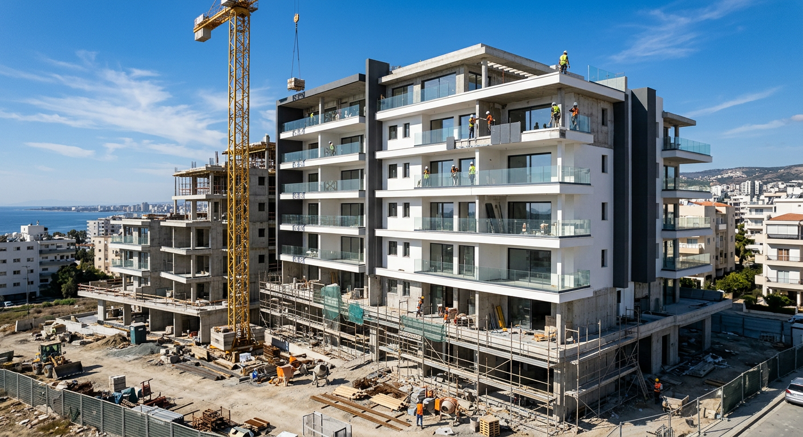

# Новости Кипр — Иран: 12 ноября 2026 (утро)

*Автоматический сбор. Найдено статей: 1*

---

## 1. На Кипре выбрали аренду вместо покупки жилья вот почему это касается вас

> **Источник:** Cyprus Mail | **Дата:** 12.11.2026 06:02 | **Теги:** `недвижимость` `переезд и релокация` `жилой рынок`

> [Оригинал: Build-to-Rent opens new doors for housing in Cyprus and Greece](https://cyprus-mail.com/2026/11/12/build-to-rent-opens-new-doors-for-housing-in-cyprus-and-greece)

Две недели назад я встретил человека из Таллина, который пришел на Кипр на год по контракту. Ему предложили либо снять квартиру в старом кипрском доме за небывалые деньги, либо посмотреть новый жилой комплекс, построенный специально для арендаторов. Цена была в три раза ниже. Когда я услышал это, понял: жилищный рынок на Кипре меняется в реальном времени, и большинство просто это не заметили.

### Почему Кипр меняет политику

Десятилетиями государство на Кипре и в Греции делало упор на одно: каждый должен купить свой дом. Были субсидии для первых покупателей, льготные кредиты, налоговые льготы. Логика была чисто кипрской: недвижимость — это не товар, это святое. Свой угол, свой кров, свой фундамент.

Но эта модель дала трещину. Во-первых, жилья стало не хватать. Цены выросли так, что человеку, который приезжает на остров на несколько лет или для удалённой работы, копить на первоначальный взнос просто нецелесообразно. Во-вторых, на Кипр хлынули экспаты: IT-специалисты, фрилансеры, удалённые работники из Европы и России. Им нужна хорошая долгосрочная аренда, а не ипотека на 25 лет. В-третьих, государство наконец понял: долгосрочная аренда — это тоже деньги в казну, налоги, развитие экономики.

### Что такое Build-to-Rent

Build-to-Rent (буквально: строительство для аренды) — это модель, при которой инвесторы не строят жилые комплексы для продажи, а возводят их специально для долгосрочной аренды. Это не airbnb, не туристические апартаменты на неделю. Это дома для людей, которые живут на острове стабильно, может быть, несколько лет подряд.

Для инвестора привлекательность очевидна: вместо того чтобы ждать, пока раскупят все квартиры, он получает предсказуемый доход. Каждый месяц — платежи. Никакой пустой квартиры, никаких пиков и падений туристического сезона. Для жильца это тоже удобно: новая квартира в современном комплексе, нормальная изоляция, кондиционирование, интернет на скорости — не сравнить со старыми апартаментами в кипрских домах семидесятых годов.

### Почему это идеально для экспатов

Представьте: вы переехали на Кипр по работе или вам нравится здесь жить. Нужно жилье. Первый путь — копить на первоначальный взнос, разбираться с кипрским законодательством об ипотеке, передавать документы в банк, ждать одобрения. Это три-четыре месяца на то, чтобы начать жить, и горы бюрократии. Второй путь: найти квартиру в комплексе Build-to-Rent, подписать договор, переехать через две недели.

Кроме удобства есть ещё один плюс: гибкость. Вы не знаете, останетесь ли на Кипре на два года или на пять. Коммерческие комплексы для аренды обычно предлагают условия, при которых вы можете уйти при нужде, без штрафов за досрочный выход. Не то, что с ипотекой.

### Новый класс активов для инвесторов

Кипр давно привлекает инвесторов со всего мира. До сих пор единственный способ вложиться в недвижимость — купить квартиру, сдать её в краткосрочную аренду туристам, надеяться, что летом будут гости, а зимой не будет пустой траты. Теперь есть вариант посолиднее: вложиться в Build-to-Rent комплекс, получать стабильный процент от доходов компании-оператора, не мучиться с непредсказуемым туристическим сезоном.

Государство уже поняло выгоду: если привлечь инвестора, который построит 200 квартир для долгосрочной аренды, это эффективнее, чем ждать, пока 200 человек купят квартиры по отдельности. Растёт предложение жилья, стабилизируется рынок, налоговые поступления становятся более предсказуемыми.

### Когда это начнёт видно

Политический сдвиг уже начался. На Кипре в крупных городах — Лимассоле, Никосии, Пафосе — уже объявлены первые серьёзные проекты Build-to-Rent. Они не будут готовы в 2026 году, но в течение ближайших трёх-четырёх лет, к 2029-2030 году, вы начнёте видеть новые жилые кварталы, где большинство квартир — именно для долгосрочной аренды.

Это приведёт к нескольким изменениям на рынке. Во-первых, качество аренды вырастет: конкурировать со старыми домами сложно, нужны стандарты. Во-вторых, цены на аренду будут давить вниз, потому что предложение начнёт расти, а спрос станет выборчивее. В-третьих, если вы сейчас сомневаетесь приезжать на Кипр из-за жилья, в 2027-2028 году вам будет намного удобнее найти нормальное жилье по справедливой цене.

### Что это означает для рынка в целом

Для людей, которые купили квартиру на Кипре несколько лет назад как инвестицию, новость может быть неоднозначна. Если государство направляет спрос на аренду, темп роста стоимости недвижимости может замедлиться. Квартира, которая росла в цене на 5-7% в год, может начать расти на 2-3%. Это нормально для зрелого рынка, но инвесторов может разочаровать.

Однако с другой стороны, это хорошая новость для людей, которые планируют жить на Кипре, а не спекулировать на недвижимости. Рынок становится гибче, доступнее, менее зажат в ипотечные платежи. Экономика начнёт двигаться быстрее, потому что люди не застывают в статусе "копим на дом", а живут, работают, тратят деньги, создают спрос.

### Что делать, если вы планируете переезд

Если вы сейчас принимаете решение: ехать на Кипр или нет — держите в голове, что жилищный рынок сейчас в переходном периоде. Старая модель покупки ослабевает, новая модель аренды набирает силу. Это работает в вашу пользу. Ищите новые проекты через крупные агентства недвижимости, через застройщиков, через сайты объявлений (там уже появляются комплексы с пометкой "новое здание, долгосрочная аренда"). Цены на такое жильё обычно справедливые, а условия несравнимо лучше, чем в домах 1980-х годов.

Если вы инвестор, сейчас время присмотреться к первым комплексам. Первопроходцы обычно получают лучшие условия, потому что политический риск для государства ниже. Модель Build-to-Rent не революция для Кипра, но эволюция, которая будет развиваться десять лет.

### Что дальше

На Кипре начинается новая глава жилищной истории. Вместо священного "свой дом" приходит более практичное "качественное жилье, в котором я живу здесь и сейчас". Это не потеря мечты, это адаптация к реальности: когда остров становится международным центром, люди приезжают на разные сроки, нужна гибкость.

Если вы откладывали переезд на Кипр, опасаясь недоступного жилья, то новость позитивна: рынок готовится к вам. И не только готовится — уже строит.

---
