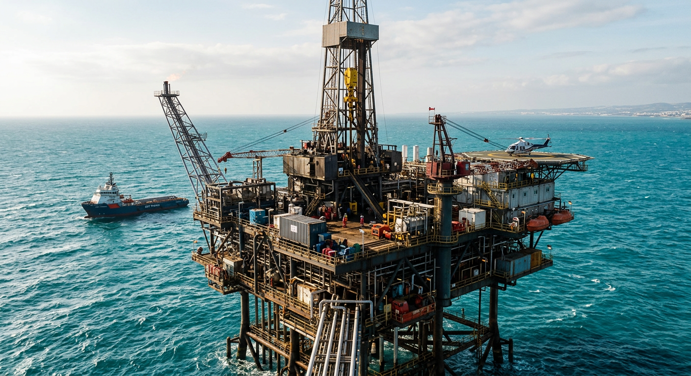

# Новости Кипр — Иран: 12 ноября 2026 (утро)

*Автоматический сбор. Найдено статей: 1*

---

## 1. Кипр подписал контракт на экспорт газа, который перевернёт остров через два года

> **Источник:** Серия: cyprus-natural-gas-export-plans | **Дата:** 26.10.2026 07:00 | **Теги:** `Газ и энергетика` `Инфраструктура` `Инвестиции` `Кипр на энергетической карте Европы`

> [Оригинал: Cyprus signs major gas deal, with Kronos production targeted for 2028 - Knews, Kathimerini](https://news.google.com/rss/articles/CBMirgFBVV95cUxOU3ZyQ29KeTFwRzlNWWFHV3NQZ2VwaUdlalF0QkJGdTNlUF9VTUc4NS13T3hscHFmMmZvQmFxc2pfSTJlcks2enlYbVB5TWsyb3FrNHByWUdVMUlTV2tWc2lqT2F4RHQ3VG55dTdaZk5lclFVX0NKVHo5bFE3MV9qUVB5WktKWTB3NGJrYS10YzNKN2phYjBLZGI2U1lHYTh4OGVIZmk4U3RqTnRrc3c?oc=5)

В прошлой части мы разбирались, как кипрский газ из месторождения Афродита попадёт в Европу через египетские пакгаузы — необычный маршрут, но выигрышный. Теперь история входит в решающую фазу: Кипр подписал ключевое соглашение по проекту Kronos (также известному как Cronos), и это означает одно — первая добыча газа начнётся уже в 2028 году.

Два года. Время, за которое остров переходит из категории энергетического должника в категорию поставщика. Это не просто хозяйственное событие — это точка, где меняется вся траектория развития острова, его роль в Европе и положение каждого из вас на Кипре.

### Kronos: почему первую скважину назвали именно так

Проект имеет странное имя для столь амбициозного предприятия. Kronos (или Cronos) — не бренд, не аббревиатура, а просто обозначение. Но за этим скромным названием стоит одна из самых массивных энергетических инфраструктур в истории острова.

Месторождение Афродита, расположенное в восточной части кипрского шельфа, — это не маленькая скважина для пробы. Здесь говорят о сотнях миллионов кубометров природного газа. Оператор проекта, компания Eni (итальянская нефтегазовая корпорация), уже подписала контракт, и машина в движении.

Первая фаза добычи стартует в 2028 году. Это означает, что буровые установки, трубопроводные системы, компрессорные станции — всё это должно быть установлено, протестировано и готово работать к этому сроку. Два года для проекта такого масштаба — это не «скоро». Это сейчас.

### Тысячи рабочих мест, которые уже ищут руки

Строительство газовой инфраструктуры — это не офисная работа. Речь идёт о тысячах специалистов на период сооружения платформ, закладки трубопроводов, монтажа оборудования. На острове, где около 1,2 миллиона человек, появление такого спроса на рабочую силу — это землетрясение для рынка труда.

Сама операция потребует постоянного персонала для технического обслуживания, контроля и управления добычей. Это не временные вакансии. Речь о стабильной занятости на десятилетия вперёд.

Но это только прямые рабочие места. Косвенно выигрывают логистика, строительство объектов инфраструктуры, гостинично-ресторанный бизнес для иностранных рабочих, поставки материалов и услуг. Нарастающий эффект уже видят девелоперы и бизнесмены, планирующие перестройку портов и прилегающих к ним территорий.

### Казна острова наполняется

Гос бюджет Кипра живёт на налоги от туризма, финансовых услуг и недвижимости. Это нестабильно: туристы уходят, финансовый сектор колеблется, рынок жилья переживает циклы. Газ — это иной уровень предсказуемости. Это ежегодные валютные поступления, которые не зависят от моды или экономических циклов.

При такой налоговой базе государство может, по крайней мере в теории, ослабить налоговое давление на малый и средний бизнес — одну из главных проблем кипрских предпринимателей. Может вложиться в инфраструктуру, здравоохранение, образование без новых заимствований.

Энергоснабжение острова тоже перестанет быть полностью импортозависимым. Кипр на 90 процентов покупает электроэнергию с материка. Местный газ — это не только экспорт, но и возможность дешевлей генерировать собственное электричество. Цены на электроэнергию, которые уже пугают инвесторов, вероятно, упадут.

### Кому это выгодно сейчас же, а кому выгодно потом

Для предпринимателя, работающего на Кипре в 2026 году, Kronos — это сигнал стабильности. Eni не просто так вкладывает миллиарды. Это означает, что остров больше не опасный периферийный рынок, а точка, где сосредоточена реальная геополитическая и энергетическая значимость.

Для инвестора, приходящего на Кипр с капиталом, появление такого якорного проекта — это подтверждение макростабильности. Когда Eni говорит «мы здесь на двадцать лет», это переиграет любые опасения о политических рисках.

Для семьи, которая рассматривает переезд на Кипр, появление тысяч новых рабочих мест означает, что их профессиональные навыки станут нужнее. Спрос на IT-специалистов, инженеров, управленцев вырастет. Рынок жилья будет развиваться вокруг новых центров занятости.

Для европейской энергетической политики Кипр становится решением. Европа остро нуждается в диверсификации газовых поставок после того, как перестала полагаться на российский газ. Восточное Средиземноморье — это новый фронт энергетического суверенитета. Кипр из песчинки становится ключевой игроком.

### Но вопросы остаются

Контракт подписан, сроки объявлены, но остаётся масса деталей, которые не проговариваются в пресс-релизах. Сколько реально будет добываться газа в год? Какой процент будет оставаться на острове, а какой идти на экспорт? Какие именно налоговые условия согласованы с Eni? И самое главное — насколько устойчива эта модель, если завтра цены на газ упадут на мировом рынке?

Ени не первый раз работает с мировой энергетикой, но это первый раз Кипру предстоит управлять таким масштабом. История показывает, что страны часто проигрывают в таких контрактах просто из-за недостатка опыта в переговорах с крупными корпорациями. Какие подводные камни спрятаны в документации соглашения — это станет ясно позже.

В следующей части мы посмотрим, что именно скрывается за цифрами контракта, почему Eni выбрала именно этот маршрут через Египет, и кто настоящий выигрыш в этой игре. Потому что газ — это не просто энергия. Это власть, деньги и статус на международной сцене.

---
