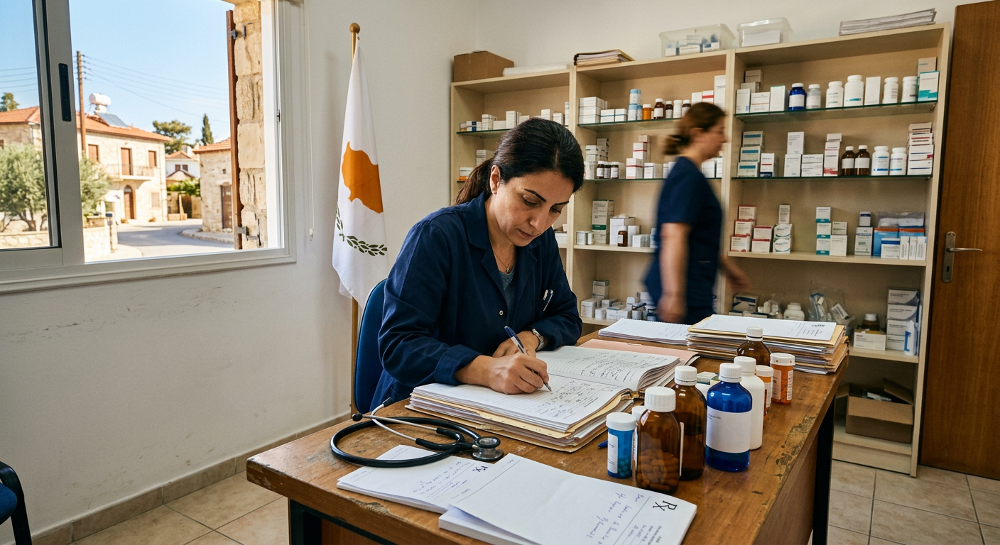

# Новости Кипр — Иран: 17 ноября 2026 (утро)

*Автоматический сбор. Найдено статей: 1*

---

## 1. Как на Кипре найти врача и получить нужный рецепт

> **Источник:** Reddit r/cyprus | **Дата:** 16.11.2026 13:12 | **Теги:** `здравоохранение` `жизнь-на-кипре` `переезд` `практика`

> [Оригинал: Mounjaro and Fluoxetine in Cyprus](https://www.reddit.com/r/cyprus/comments/1xxozyp/mounjaro_and_fluoxetine_in_cyprus/)

Вы приехали на Кипр, заболели — и вдруг понимаете, что не знаете, куда идти и кого просить. Ещё страшнее, если нужен конкретный препарат: найти врача, который согласится выписать лекарство, кажется непреодолимо сложным. По рассказам русскоязычных жителей, многие приезжают именно с этим страхом. Но на самом деле система работает проще, чем кажется — нужно просто понять её логику.

### Почему новичкам кажется, что это невозможно

Первое, что шокирует человека из постсоветского пространства: на Кипре не существует участкового врача, который выписывает всё подряд по вашей просьбе. Здесь не принято приходить с диагнозом и требовать определённый препарат — врач назначает то, что, по его мнению, вам нужно. Это звучит как ограничение свободы, но на практике это всего лишь другой принцип: медик несёт ответственность за назначение.

Второе препятствие для новичка — языковой барьер. Если у вас нет страховки GESY (государственной системы здравоохранения), вы не можете просто прийти в поликлинику и увидеть врача. Нужно либо записаться в частную клинику, либо разобраться с государственной системой. Кроме того, медицинская терминология по-английски отличается от русской — препараты имеют другие названия, симптомы описываются иначе.

Третья причина беспокойства — страх перед бюрократией. Документы, справки, регистрация — всё это действительно требуется, но это не лабиринт, а просто иная процедура.

### Как работает государственная система GESY

Если вы работаете на Кипре официально или владеете бизнесом, вы платите в государственную страховку GESY. Взносы удерживают с зарплаты (примерно 1,85% от дохода) или вы платите самостоятельно, если вы предприниматель. На практике это означает, что вы можете обратиться в государственный центр первичной медицинской помощи (Primary Health Care Centre) совершенно бесплатно.

Дело в том, что государственная система требует регистрации. Вы выбираете врача общей практики (GP) в одной из поликлиник вашего района. Это ваша первая точка входа в систему. Врач уже потом, если нужно, направляет вас к специалисту. Записываться туда можно по телефону или онлайн через портал uclh.org.cy. Ждать придётся несколько дней или недель в зависимости от загруженности.

Важный момент: в государственной системе врачи назначают лекарства из утверждённого списка. Если вам нужен редкий или дорогой препарат, врач может отказать, если не видит медицинского обоснования. Это не вредность — это политика экономии бюджета.

### Частные врачи: быстро и без ограничений

Если у вас нет страховки или вы не хотите ждать, вариант очевиден: частная клиника. На Кипре их тысячи. Цена первичного приёма у врача общей практики в частной клинике колеблется от 40 до 80 евро, в зависимости от района и репутации. Если вам нужен специалист — кардиолог, невролог — счёт идёт на 60–120 евро за приём.

Солидные частные клиники есть во всех крупных городах. В Никосии и Лимасоле работают международные медицинские центры с филологически подготовленным персоналом. Записаться можно по телефону, через WhatsApp или приложение. Результат: вы видите врача в течение дня или на следующий день.

Там важный плюс: врач в частной клинике обычно выписывает то, что вы просите, если это медицински оправдано. Если препарат не входит в государственный список, вы просто платите за него сами в аптеке — но это уже ваше решение.

### Как получить рецепт и где его заполнить

После приёма врач выписывает рецепт. Это лист бумаги с печатью врача и его подписью. В государственной системе это один формат, в частных клиниках может быть другой. На рецепте указаны название препарата, дозировка и количество таблеток.

Что важно знать: рецепт действует 30 дней с момента выписки. Вы берёте его и идёте в аптеку. На Кипре аптеки везде — в каждом торговом центре, каждом жилом районе. Фармацевт читает рецепт, проверяет его подлинность в системе и отпускает лекарство. Если рецепт выписан в государственной системе (GESY), вы платите только символическую коплату — примерно 0,50–1,50 евро на препарат, остальное оплачивает страховка. Если рецепт приватный, вы платите полную стоимость препарата.

Если препарата нет в наличии, фармацевт может предложить аналог того же действия. Аналоговые препараты на Кипре доступны — производители выпускают десятки вариантов одного и того же лекарства под разными названиями.

### Какие документы нужны при переезде на Кипр

Если вы только переехали, первое, что нужно сделать, — встать на учёт в муниципалитете. Это ключевой документ. Затем — открыть счёт в банке (это даст вам налоговый номер) и зарегистрироваться в системе GESY, если вы работаете официально.

Для врача при первом посещении приносите паспорт и страховой номер GESY (если у вас есть). В частной клинике обычно просят заполнить анкету: базовая информация, история болезней, аллергии. Если у вас есть медицинская карта из России или другой страны, её можно взять с собой — врач поймёт масштаб ваших проблем со здоровьем, но он не станет слепо следовать старым диагнозам. Он проведёт свои исследования.

### Где найти англоговорящего врача

Это волнует иностранцев больше всего. Хорошая новость: на Кипре почти все врачи говорят по-английски. Плохая: уровень варьируется. В крупных частных клиниках персонал говорит свободно. В государственных поликлиниках английский есть, но иногда нужен переводчик.

Как найти? Первый вариант — позвонить в клинику и спросить, есть ли врач, говорящий по-русски или свободно по-английски. Многие врачи на Кипре учились или практиковали за границей — в Великобритании, США, Австралии. Второй вариант — посмотреть профили врачей в интернете: на сайтах клиник часто указано образование врача и языки. Третий — спросить в русскоязычных чатах Кипра, какого врача рекомендуют.

Для англоговорящих жителей работают также благотворительные организации, которые помогают найти врача, если у вас нет средств на приватника. Например, на Кипре действуют центры помощи иммигрантам, которые подскажут бесплатного врача.

### Что ещё нужно знать про лекарства

На Кипре огромный выбор аптек — от сетевых до небольших семейных. Почти все они принимают электронные рецепты. Цены на лекарства выше, чем в России, но ниже, чем в западной Европе. Парацетамол стоит 3–4 евро, антибиотик из расчета на курс — 15–25 евро в приватной аптеке.

Есть один лайфхак: если препарат дорогой, попросите врача выписать его в государственной системе — взнос будет минимальный. Если это невозможно, спросите фармацевта, есть ли более дешёвый аналог с тем же действующим веществом. Кипрские фармацевты обычно помогают: это не только бизнес, но и профессия, люди относятся к ней ответственно.

### Экстренная медицина: если что-то срочное

Если вам плохо ночью или в выходной, не ждите приёма. На Кипре есть дежурные центры (urgent care centres) в крупных городах. Они работают до позднего вечера и выходные. Приём там стоит 15–30 евро. Если совсем критично — вызывайте скорую (номер 112). Машина приедет, врач оценит состояние, при необходимости отвезёт в больницу. В государственной больнице первая помощь бесплатна для всех, независимо от страховки.

### Главное, что нужно понять

Медицина на Кипре работает по честной логике: врач несёт ответственность за назначение, пациент должен следовать рекомендациям. Вы не можете прийти и потребовать конкретное лекарство, как в России, — но вы можете обсудить с врачом ваши опасения и попросить альтернативу. Хороший врач выслушает и найдёт компромисс.

Если вы новичок на Кипре, начните с частной клиники — это проще в бюрократическом смысле и быстрее. После того как разберётесь с системой, можете зарегистрироваться в GESY для плановой медицины. Рецепты — просто бумажка, не пугайтесь. Главное — найти врача, которому вы доверяете. На этом острове таких достаточно.

---
