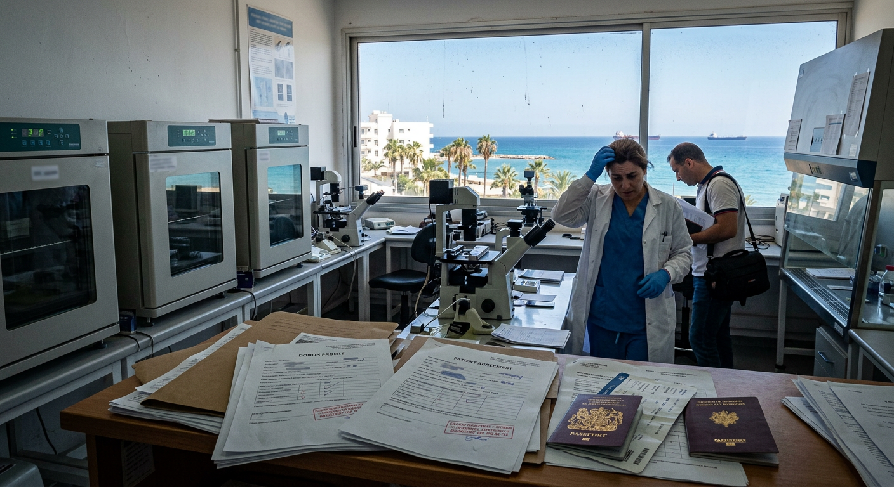

# Новости Кипр — Иран: 18 ноября 2026 (утро)

*Автоматический сбор. Найдено статей: 1*

---

## 1. Скандал с донорами ЭКО на Кипре достиг Австралии и открыл международный масштаб

> **Источник:** Серия: eko-donors | **Дата:** 10.11.2026 20:18 | **Теги:** `Скандал в клиниках ЭКО` `репродуктивный туризм` `безопасность пациентов`

> [Оригинал: Australian couples linked to Crete IVF scandal amid shocking new allegations - The Greek Herald](https://news.google.com/rss/articles/CBMirgFBVV95cUxOVU5hY1F1cWs2RFg3eTBHZDJkRnc0UUE1aUVHR1Q2NjdpZjJqRDVJWndaNmkxUk55eFRXekxzZjBUOGJIRkhSUHRYSktLSWsyRUc0OGFScERIMWpmZzhxN1pmTURJT2pPUEgzc1BpOVJ4VllVcTJMY1U4TzRacl95c0tmdlNnTnd0S3NFT3FleDFyUHZTWVBjeFlrSTltZWp3SjZvQ2Zwb0pnVTJTQkE?oc=5)

В прошлой части мы выяснили: учёные доказали, что обман с донорами на Кипре — это система, а не случайная ошибка одной клиники. Турция арестовала контрабандистов. Кипрские власти начали возмущаться обвинениями. Казалось, история развивается по локальному сценарию: остров, британские пациенты, региональные конфликты. Но вот новость из Австралии перевернула весь расклад.

Австралийские семьи, которые обращались в кипрские клиники ЭКО, прошли генетическое тестирование своих детей и получили результаты, идентичные тому, что нашли британцы: несовпадение с выбранным донором. Беременности наступали именно во время процедур на Кипре. Семьи начали связывать факты, обращаться к адвокатам, готовить судебные иски.

### История перестала быть только британской проблемой

До сих пор расследование казалось сугубо английским конфликтом. BBC опубликовала репортаж о клинике в Никосии. Британские пары обратились в суд. Турция арестовала 36 человек по делу о контрабанде яйцеклеток. Кипрские власти отрицали или минимизировали обвинения. Все события укладывались в понятную схему: острые противоречия между местными и приезжими, напряженность в треугольнике Кипр — Турция — Британия.

Теперь схема рассыпается. Австралийцы — не единственные неангличане, обнаружившие подмену. По данным из открытых источников, семьи из других стран Европы, Азии и Северной Америки уже готовят иски. Они обратили внимание на британское расследование, сделали тесты, получили результаты, начали считать. И считать начали серьёзно.

### Почему именно Кипр стал центром ЭКО-туризма

Кипр — действительно один из крупнейших центров вспомогательной репродукции в Европе. Процедуры здесь обходятся в среднем на 30-50% дешевле, чем в Великобритании или Австралии. В Австралии полный цикл ЭКО может стоить свыше 15 тысяч австралийских долларов. На Кипре — существенно меньше. Эта разница огромна для семей, которые пытаются зачать ребёнка. Она пересекает границы. Она заставляет людей лететь на остров.

Низкие цены — прямое следствие низких расходов и минимальной регуляции. На Кипре нет таких строгих требований к клиникам, как в развитых странах. Документооборот проще. Надзор мягче. Клиники могут нанять меньше персонала, требовать меньше отчётности, работать в более гибком режиме. Всё это позволяет держать цены низкими. Но цена — слово двусмысленное. Низкая цена обслуживания часто означает низкое качество контроля.

Для кипрских клиник это было идеальное уравнение: растущий спрос из Европы и мира, небольшое количество местных пациентов, высокие маржи, минимальные требования. За 2010-2025 годы кипрский ЭКО-туризм стал миллионным бизнесом. Семьи приезжали, проходили процедуры, улетали. Если всё проходило успешно, клиника получала благодарность. Если что-то шло не так — пациент был далеко, в другой стране, иногда на другом континенте.

### Масштаб подмены с донорами растёт

Теперь выясняется: где-то в этой системе появилась дыра. Большая дыра. Австралийцы обратили внимание не случайно. Генетические тесты давно перестали быть редкостью. Родители делают их детям для интереса, для здоровья, для профилактики. Никто не ищет беду. Но когда результат не совпадает с ожиданием — результат, полученный в авторитетной лаборатории — люди начинают искать объяснения.

Первый австралиец обнаружил несовпадение. Потом второй. Потом они связались друг с другом. Потом с адвокатом. Потом история попала в местные СМИ. Потом в международные. Сейчас число австралийских семей, подтвердивших подмену, растёт. По открытым данным, речь идёт уже о десятках случаев. И это только те, кто решился на тест. Сколько других семей всё ещё не знают? Сколько детей живут с генетическим несовпадением, о котором родители не догадываются?

### Почему австралийцы смогли разоблачить то, что миновало других

В Австралии регулирование ЭКО строгое. Когда местные пары обращались на Кипр, они предполагали: да, остров менее богатый, да, клиники менее известные, но глобальные стандарты соблюдаются везде. Это был расчёт на всеобщую честность системы. Оказалось, расчёт был наивен.

Когда дети рождались, австралийские родители ожидали, что всё будет как дома: надёжность, документация, ясность. Когда ничего этого не было — они начали действовать. В Австралии люди привыкли требовать ответов от системы. Они знают, как подать жалобу, как найти адвоката, как обратиться в регулятор. У них есть деньги на судебные разбирательства. Они готовы ждать годы ради справедливости.

А ещё австралийцы стали роком для скандала потому, что они пришли позже. Они услышали о британском расследовании. Они получили план: что искать, какой врач, какая клиника, какие вопросы задавать. Они пошли проверять. И нашли.

### Международный суд — новая арена борьбы

Теперь дело перестаёт быть спором между британской семьёй и кипрской клиникой. Теперь это — вопрос о международной ответственности. Европейские суды начинают проявлять интерес. Юристы обсуждают прецеденты. Адвокаты готовят доказательства для исков, которые могут рассматриваться не в кипрских, а в европейских инстанциях.

Дело осложняется тем, что северный Кипр не признаётся международным сообществом, но Республика Кипр — член ЕС. Кто несёт ответственность? Кипрские власти? Клиники как частные субъекты? Международное сообщество? Евросоюз? Каждый вопрос открывает ящик Пандоры.

Турецкие аресты контрабандистов показали: материал для яйцеклеток поступал извне, через чёткую сеть. Но клиники на Кипре знали это или нет? Если знали — они соучастницы. Если не знали — это вопрос к системе надзора. В обоих случаях кто-то должен ответить.

### Репутация кипрского здравоохранения под угрозой

Для острова это катастрофа мягкая, но глубокая. Медицинский туризм — важная статья доходов. На Кипре работают сотни клиник, которые обслуживают иностранных пациентов. Люди приезжают на зубы, на пластическую хирургию, на ЭКО, на лечение рака. Каждый иностранный пациент — валюта. Каждая успешная процедура — реклама.

Теперь эта репутация подточена. Если одна клиника обманывает с донорами, может ли быть уверена в других? Если контроль оказался неработающим в одной области, может ли работать в других? Потенциальные пациенты будут думать долго, прежде чем забронировать процедуру на Кипре.

Для кипрских властей это — вызов легитимности. Они должны показать: дело под контролем, проблема локализована, система будет исправлена. Но каждый день без явных действий — это день, когда доверие падает на целый процент.

### Что ждёт клиники и регуляторов

Дженерик-регулятор ЭКО на Кипре вскоре столкнётся с беспрецедентным давлением. Австралийские адвокаты станут требовать документы. Британские судьи могут выдать приказ о предоставлении информации. Евроинспекторы могут потребовать аудит. ООН может направить запрос о соблюдении прав человека.

Кипрские клиники, которые не причастны к скандалу, пострадают от амнезии. Люди начнут путать случайные клиники с проблемной. Это часто происходит в краях, где репутация неоднородна. Если один врач украл пациента, страдает весь район. Если одна клиника обманула с донорами, страдает вся индустрия.

Регулирование, вероятно, ужесточится. Это поднимет цены. Это может снизить количество процедур. Но это необходимо. Система без контроля — это не система, это казино. И казино, где ставка — жизнь человека и его ребёнка.

### От расследования к судебным разбирательствам

В следующих месяцах ожидаются первые официальные ответы. Кипрские власти не смогут молчать дольше. Им придётся либо провести независимое расследование, либо ещё раз отрицать обвинения, либо обвинять внешних виновников — контрабандистов, турецкие сети, иностранных агентов.

Австралийцы буду требовать справедливости. Британцы — компенсации. Европейское сообщество — изменений в регулировании. И каждый процесс будет — увеличивающей линзой, через которую мир смотрит на кипрское ЭКО.

История перестала быть делом одной клиники в Никосии. Это больше не региональный скандал. Это — международный кризис доверия, который заставит переписывать правила репродуктивного туризма на Средиземноморье.

Что именно будет переписано, кто поведёт процесс, какие будут первые вердикты — об этом в следующей части.

---
